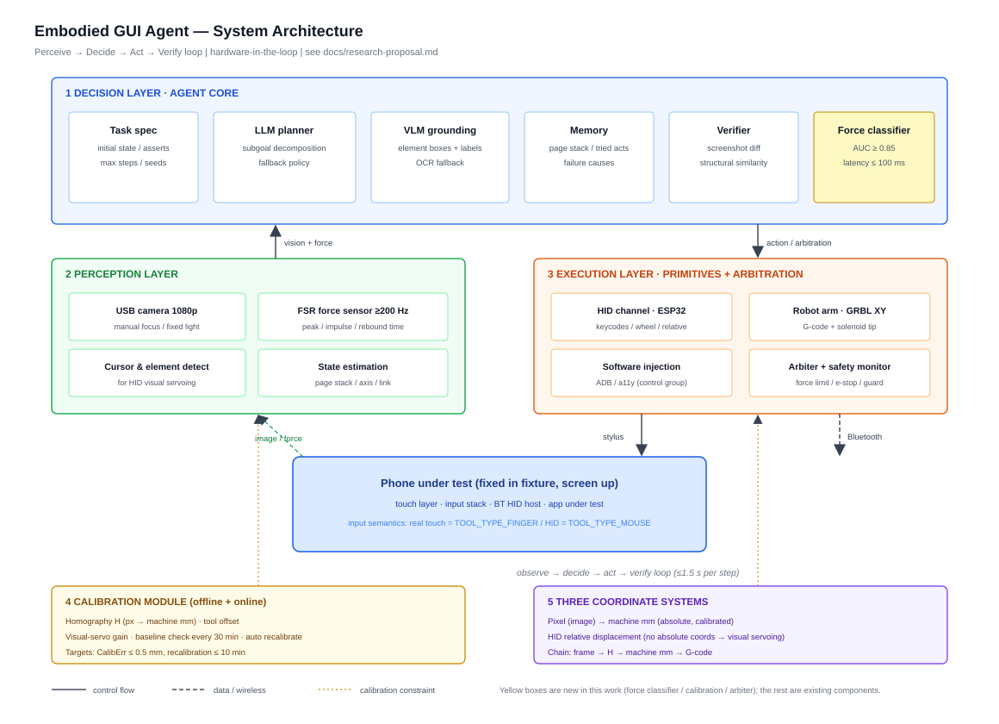
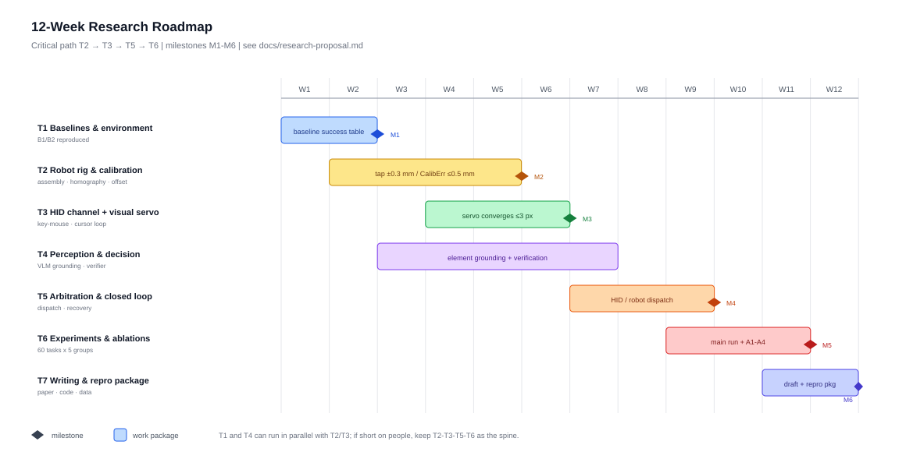

# Embodied GUI Agent

**A vision + LLM agent that operates a real smartphone through a physical robotic arm — with force–vision closed-loop feedback.**

[](docs/research-proposal.md)
[](LICENSE)
[](docs/research-proposal.md)
[](docs/)
[](#built-with-deepseek-harness)
[](https://github.com/xiaowangkkk1231/embodied-gui-agent/actions/workflows/ci.yml)

**English** | [简体中文](README.zh-CN.md)

> **Status: v0.1 — design & documentation phase.** This repository currently contains a
> research proposal, system architecture, hardware BOM, calibration/scheduler design and an
> evaluation protocol. Run-time code is **not** included yet — see the [roadmap](#roadmap).

---

## Why

Mainstream mobile GUI agents (AppAgent, Mobile-Agent, AutoGLM, …) execute actions through
**software injection**: ADB, the accessibility service, `uiautomator`. That path collapses in
exactly the places that matter:

| Failure mode | Example |
|---|---|
| Injection blocked | secure keyboards, payment sheets, game engines, DRM video players |
| Semantics not equivalent | widgets that only accept `TOOL_TYPE_FINGER` ignore synthetic events |
| Simulator ≠ device | success measured in an emulator does not transfer to real hardware |
| No physical feedback | the agent cannot tell whether a tap was *accepted* by the system |

This project studies the **embodied alternative**: a camera observes the screen, a VLM grounds
UI elements, and a **physical stylus driven by an XY gantry** performs the touch — optionally
assisted by a Bluetooth/USB **HID** channel for text, navigation and scrolling. On top of that we
add a sensing channel no software agent has: **contact force**.

## Research questions

| ID | Question | Key metric |
|---|---|---|
| RQ1 | Does embodied execution expand the reachable task set? | success rate on touch-only UIs |
| RQ2 | Can contact-force signals self-supervise "tap accepted / rejected"? | AUC ≥ 0.85, latency ≤ 100 ms |
| RQ3 | What is the optimal HID ↔ robot arbitration policy? | latency–success Pareto front |
| RQ4 | Can online self-calibration make one rig work across phone models? | error ≤ 0.5 mm, recal ≤ 10 min |
| RQ5 | How many touch gestures can a single-point finger + HID cover? | gesture coverage matrix |

## System at a glance



Three coordinate systems are involved (pixels → machine millimetres → HID relative displacement);
the HID channel has no absolute coordinates, so it is driven by **visual servoing on the on-screen
pointer sprite**. Details in [`docs/scheduler-and-calibration.md`](docs/scheduler-and-calibration.md).

Physical layout and the tap-head detail:


> Chinese-labelled versions of the figures: [architecture](docs/assets/system-architecture.zh-CN.svg) ·
> [three views](docs/assets/three-views.zh-CN.svg) · [roadmap](docs/assets/roadmap-gantt.zh-CN.svg).

## Repository map

```
.
├─ README.md                        this file
├─ README.zh-CN.md                  Chinese overview
├─ docs/
│  ├─ research-proposal.md          RQs, system design, experiment plan, risks
│  ├─ related-work.md               5 threads + gap statement
│  ├─ scheduler-and-calibration.md  state machine, arbitration, homography, visual servo
│  ├─ evaluation-protocol.md        task YAML, 13 metrics, log schema, statistics
│  └─ assets/                       architecture · three views · roadmap  (EN + .zh-CN)
├─ hardware/
│  ├─ BOM.csv                       44 line items, ~¥871 (≈US$120) without tools
│  └─ README.md                     assembly notes and design constraints
├─ src/                             (planned) calibration, servo, scheduler, GRBL client
├─ scripts/check_assets.py          CI: SVG well-formedness, CSV shape, relative links
└─ .github/                         CI workflow, issue/PR templates
```

## Hardware summary

| Subsystem | Contents | Cost (CNY) |
|---|---|---|
| Mechanics | 2020 extrusion, 8 mm rods, GT2 belts, 2× NEMA17, printed parts | 446 |
| Motion control | Arduino UNO + CNC Shield + GRBL, A4988, solenoid tap head | 172 |
| HID channel | ESP32 (BLE HID / USB OTG) | 30 |
| Force sensing | FSR402 ×2, HX711 load cell | 63 |
| Vision | 1080p manual-focus camera, ring light, calibration target | 160 |
| **Total (no tools)** | | **871** |

Full list: [`hardware/BOM.csv`](hardware/BOM.csv).

## Roadmap



| Weeks | Milestone |
|---|---|
| W1–2 | Baselines (ADB, accessibility) reproduced; baseline success table |
| W3–4 | Rig assembled + calibrated; tap repeatability ±0.3 mm |
| W5–6 | HID channel + visual servo converges to ≤3 px |
| W7–8 | Arbitration + post-action verification + recovery |
| W9–10 | 60-task benchmark × 5 groups |
| W11 | Ablations A1–A4 + force classifier |
| W12 | Paper draft + reproduction package |

## Prior art & related projects

Moving a stylus over a phone is not new — it has ten years of open-source and commercial history.
The contribution here is *what gets measured*, not the fact that a stylus moves. Honest comparison:

| Project | What it is | Overlap | Difference here |
|---|---|---|---|
| [Tapster](https://github.com/hugs/tapsterbot) (310★) | CoreXY gantry + capacitive stylus, Node.js + Arduino Firmata, taps a phone for app testing | Two-axis stylus rig, conductive tip, calibration | **Open-loop scripted**: no camera-in-the-loop agent, no force sensing, no HID arbitration |
| [FlexArm](https://github.com/hamlet0168/FlexArm) (3★) | Robotic arm for real phones; camera corner-point calibration, YAML scripts, icon/text recognition | Vision calibration + scripted phone control — the closest shipped product | No force channel, no benchmark protocol; distributed as Windows binaries |
| [iPhone-Ian](https://github.com/mchdeore/iPhone-Ian) | Physical robot tapping a stock iPhone, driven by a vision-based agent | Nearly the same problem statement | iPhone-only, minimal, no measurement layer |
| [Tappy](https://github.com/robypez/ago) | TestDevLab's in-house Tapster derivative (2017) | Same as Tapster | Same as Tapster |
| [OptoFidelity TouchRobot](https://optofidelity.com/en/touch-and-hmi-testing) | Commercial multi-axis touch/HMI test robot with force control | Physical touch **with** force control | Industrial test equipment for *device quality*, not a general-purpose agent actuator |
| AppAgent / Mobile-Agent / AutoGLM | VLM agents driving phones purely through software injection | Task set, grounding methods | They never touch the device — they are the **baselines** here, not the competitors |

The gap this repository targets: none of the physical rigs above close the loop with **contact
force** *or* with a **VLM agent**, and none publishes a **comparable benchmark** across execution
channels. See [`docs/related-work.md`](docs/related-work.md) for the literature side.

## Intended use / out of scope

**Intended:** GUI-agent research, accessibility assistance, automated mobile app testing,
hardware-in-the-loop evaluation, teaching mechatronics.

**Out of scope — and not supported by this project:** driving reward/ad-revenue mechanisms of
commercial apps (click farms, reward farming, engagement fraud), evading anti-fraud systems, or
any use that violates a platform's terms of service. See [`ETHICS.md`](ETHICS.md).

## Contributing

Issues and PRs are welcome — see [`CONTRIBUTING.md`](CONTRIBUTING.md). The most useful early
contributions are: task YAMLs for the benchmark, calibration datasets, and critique of the
evaluation protocol.

## Built with DeepSeek Harness

The research proposal, the three SVG figures, the hardware BOM, the calibration/scheduler design
and the evaluation protocol in this repository were drafted in a **DeepSeek Harness (DSH)** agent
session: the agent wrote and iterated on the files, the human author set the research direction and
reviewed every claim. DSH is DeepSeek's desktop agent harness; this repository is the
documentation-only output of that workflow.

The badge above is an attribution, not a runtime dependency — reproducing the rig does not require DSH.

## Citation

If you use the design or the evaluation protocol, cite it via [`CITATION.cff`](CITATION.cff)
(GitHub renders a "Cite this repository" button once the file is present).

## License

- Code (`src/`, `scripts/`): **MIT**
- Documents and figures (`docs/`, `README*`): **CC BY 4.0**
- Hardware designs (`hardware/`): **CERN-OHL-S v2**

See [`LICENSE`](LICENSE) for the full text and the per-directory mapping.
