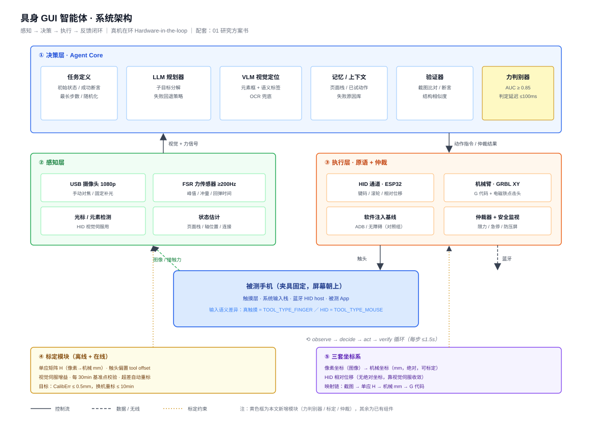
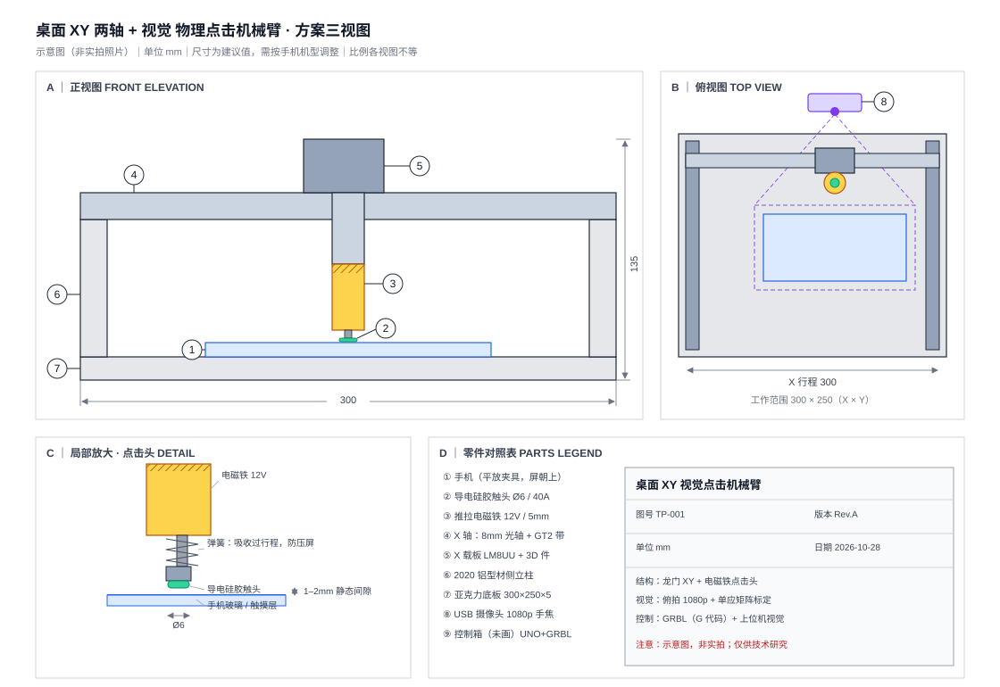
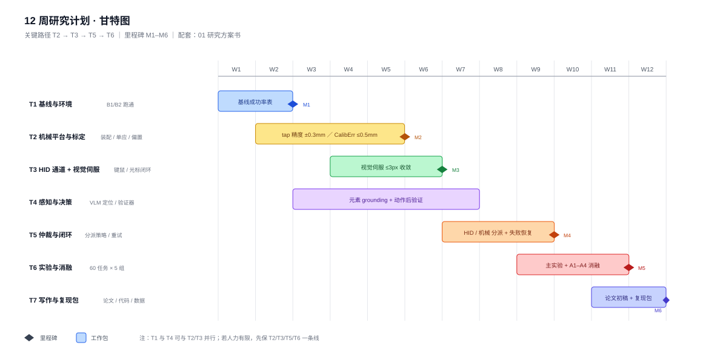

# Embodied GUI Agent · 具身 GUI 智能体

**用物理机械臂在真机上操作手机的视觉 + 大模型智能体，带力-视觉闭环反馈。**

[](docs/research-proposal.md)
[](LICENSE)
[](#使用-deepseek-harness-构建)
[](https://github.com/xiaowangkkk1231/embodied-gui-agent/actions/workflows/ci.yml)

[English](README.md) | **简体中文**

> **状态：v0.1 — 设计文档阶段。** 当前仓库包含研究方案、系统架构、硬件清单、标定与调度设计、
> 评测协议。**运行代码尚未包含**，见[路线图](#路线图)。

---

## 为什么做

主流手机 GUI 智能体（AppAgent、Mobile-Agent、AutoGLM 等）的动作都通过**软件注入**执行：
ADB、无障碍服务、`uiautomator`。这条路恰好会在最需要它的地方失效：

| 失效方式 | 例子 |
|---|---|
| 注入被屏蔽 | 安全键盘、支付页、游戏引擎、DRM 视频播放器 |
| 语义不等价 | 只接受 `TOOL_TYPE_FINGER` 的控件忽略合成事件 |
| 模拟器 ≠ 真机 | 模拟器里的成功率无法迁移到真实设备 |
| 没有物理反馈 | 智能体不知道这次点击是否被系统**接收** |

本项目研究**具身方案**：摄像头看屏幕、VLM 定位元素、**XY 龙门驱动实体触头**完成触摸；文字输入、
导航、滚动由蓝牙/USB **HID** 通道辅助。在此之上增加了一个软件智能体完全没有的感知通道：
**接触力**。

## 研究问题

| 编号 | 问题 | 关键指标 |
|---|---|---|
| RQ1 | 具身执行是否扩展可达任务集？ | 仅触摸界面上的成功率 |
| RQ2 | 接触力能否自监督判定"点击是否被接收"？ | AUC ≥ 0.85，延迟 ≤ 100 ms |
| RQ3 | HID ↔ 机械臂的最优仲裁策略是什么？ | 延迟-成功率帕累托前沿 |
| RQ4 | 在线自标定能否让一套装置跨机型复用？ | 误差 ≤ 0.5 mm，重标定 ≤ 10 min |
| RQ5 | 单点机械指 + HID 能覆盖多少种触摸手势？ | 手势覆盖矩阵 |

## 系统概览



涉及三套坐标系（像素 → 机械毫米 → HID 相对位移）。HID 没有绝对坐标，用**屏幕上光标箭头的
视觉伺服**闭环驱动。细节见 [`docs/scheduler-and-calibration.md`](docs/scheduler-and-calibration.md)。

结构三视图与点击头细节：



> 英文标注版本：[架构图](docs/assets/system-architecture.svg) ·
> [三视图](docs/assets/three-views.svg) · [甘特图](docs/assets/roadmap-gantt.svg)。

## 目录结构

```
.
├─ README.md                        英文版
├─ README.zh-CN.md                  本文件
├─ docs/
│  ├─ research-proposal.md          研究问题、系统设计、实验计划、风险
│  ├─ related-work.md               五条脉络 + 空白点定位
│  ├─ scheduler-and-calibration.md  状态机、仲裁、单应、视觉伺服
│  ├─ evaluation-protocol.md        任务 YAML、13 项指标、日志 schema、统计
│  └─ assets/                       架构图 · 三视图 · 甘特图（英文 + .zh-CN 两套）
├─ hardware/
│  ├─ BOM.csv                       44 项物料，约 ¥871（不含工具）
│  └─ README.md                     装配说明与设计约束
├─ src/                             （待实现）标定、伺服、调度、GRBL 客户端
├─ scripts/check_assets.py          CI：SVG 合法性、CSV 列数、相对链接
└─ .github/                         CI 工作流、Issue/PR 模板
```

## 硬件概览

| 子系统 | 内容 | 费用（元） |
|---|---|---|
| 机械 | 2020 型材、8mm 光轴、GT2 皮带、2× NEMA17、打印件 | 446 |
| 运动控制 | UNO + CNC Shield + GRBL、A4988、电磁铁点击头 | 172 |
| HID 通道 | ESP32（BLE HID / USB OTG） | 30 |
| 力觉 | FSR402 ×2、HX711 称重 | 63 |
| 视觉 | 1080p 手动对焦摄像头、环形补光、标定板 | 160 |
| **合计（不含工具）** | | **871** |

完整清单：[`hardware/BOM.csv`](hardware/BOM.csv)。

## 路线图



| 周 | 里程碑 |
|---|---|
| W1–2 | 复现基线（ADB / 无障碍），产出基线成功率表 |
| W3–4 | 机械平台装配 + 标定，点击重复精度 ±0.3 mm |
| W5–6 | HID 通道 + 视觉伺服收敛到 ≤3 px |
| W7–8 | 仲裁器 + 动作后验证 + 失败恢复 |
| W9–10 | 60 任务基准 × 5 组对照 |
| W11 | 消融 A1–A4 + 力判别器 |
| W12 | 论文初稿 + 复现包 |

## 已有项目与对比

“机械臂点手机”不是新问题，开源与商业界已有近十年积累。本项目的贡献在于**测什么**，而不在于“有根笔在动”。

| 项目 | 是什么 | 重叠点 | 本项目差异 |
|---|---|---|---|
| [Tapster](https://github.com/hugs/tapsterbot)（310★） | CoreXY 三轴 + 电容笔，Node.js + Arduino Firmata，点手机做 App 测试 | 两轴机械结构、导电触头、标定 | **开环脚本**：无相机闭环、无力反馈、无 HID 仲裁 |
| [FlexArm](https://github.com/hamlet0168/FlexArm)（3★） | 机械臂操作真机；摄像头角点标定、YAML 脚本、图标/文字识别 | 视觉标定 + 脚本化操作，**最接近的成品** | 无力通道、无基准协议；以 Windows 二进制发布 |
| [iPhone-Ian](https://github.com/mchdeore/iPhone-Ian) | 视觉智能体驱动的物理装置点击 iPhone | 问题陈述几乎相同 | 仅 iPhone、实现极简、无度量层 |
| [Tappy](https://github.com/robypez/ago) | TestDevLab 内部的 Tapster 改版（2017） | 同 Tapster | 同 Tapster |
| [OptoFidelity TouchRobot](https://optofidelity.com/en/touch-and-hmi-testing) | 商用手眼一体触控/HMI 测试机器人，带力控 | 物理触控**且**有力控 | 是测“设备质量”的工业设备，不是通用智能体的执行器 |
| AppAgent / Mobile-Agent / AutoGLM | 纯软件注入驱动手机的 VLM 智能体 | 任务集、定位方法 | 完全不接触设备——它们是本文的**基线**，不是竞品 |

空白点：上述机械装置没有一个把**接触力**接入闭环，也没有一个接上 **VLM 智能体**；更没有一个给出跨执行通道的可比基准。文献侧见 [`docs/related-work.md`](docs/related-work.md)。

## 适用范围 / 不适用范围

**适用**：GUI 智能体研究、无障碍辅助、App 自动化测试、硬件在环评测、机电教学。

**不适用，本仓库也不支持**：驱动商业 App 的奖励/广告收益机制（刷量、点击农场、激励作弊）、
规避平台风控、或任何违反平台服务条款的用途。详见 [`ETHICS.md`](ETHICS.md)。

## 贡献

欢迎 Issue 与 PR，见 [`CONTRIBUTING.md`](CONTRIBUTING.md)。当前最需要的是：基准任务 YAML、
标定数据集、以及对评测协议的批评。

## 使用 DeepSeek Harness 构建

本仓库的研究方案、三张 SVG 图、硬件清单、标定与调度设计、评测协议，均在 **DeepSeek Harness（DSH）**
智能体会话中起草：由智能体写作与迭代，由人类作者确定研究方向并逐条审阅。DSH 是 DeepSeek 的桌面端
智能体框架，本仓库是该工作流产出的纯文档结果。

上方的徽章只表示来源归属，复现这套装置不依赖 DSH。

## 引用

使用本设计或评测协议请通过 [`CITATION.cff`](CITATION.cff) 引用。

## 许可证

- 代码（`src/`、`scripts/`）：**MIT**
- 文档与插图（`docs/`、`README*`）：**CC BY 4.0**
- 硬件设计（`hardware/`）：**CERN-OHL-S v2**

完整文本与目录对应关系见 [`LICENSE`](LICENSE)。
